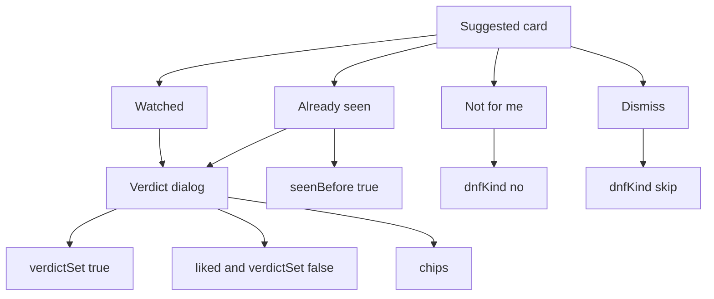

# tv-page

Phone page for a private TV list. This repo stores no shows and no tokens. The list is `tv-graph.json` in the private tv-tracker repo. A fine-grained token pasted in Settings stays in that browser.

Old rows still render when `chips`, `verdictSet`, `dnfKind`, `seenBefore`, or `score` are missing. Processor fields such as `traits`, `noteSignals`, `imdbId`, `rejected`, and `tasteModel` are left as they arrived.

## What a tap writes

| Tap | Writes |
| --- | --- |
| Watched, verdict left on liked | `status: watched`, `verdict: liked`, `verdictSet: false` |
| Verdict tapped, including Top tier | `verdictSet: true`. Top tier is stored as `top` |
| Trait chip | `chips`, toggled in place. On a watched card that tap saves by itself |
| Already seen | `status: watched`, `seenBefore: true`, then the same verdict dialog |
| Not for me | `status: dnf`, `dnfKind: no` |
| Dismiss | `status: dnf`, `dnfKind: skip` |

Chip ids, stored in this order: `pacing+`, `pacing-`, `acting+`, `story+`, `production+`, `writing+`, `dark+`, `humour+`, `too-slow`. An unknown id already on the show is kept after those. Clearing a dnf split writes `dnfKind: ""` so a merge cannot restore the old `no` or `skip`.

Suggested, Near, and Long sort by rating, then by watched-lane taste. `top` counts the same as `fantastic`. A numeric `imdb` is the rating. A `tt` id in `imdb`, or `imdbId` when `imdb` is not a rating, uses `score`.

## Check on a phone

Open the page at a narrow width, with the real list or a local copy.

1. On Suggested, rows with a `tt` id follow `score`. The number on the right is that score and opens IMDb. An older row whose `imdb` is a number still sorts on that number.
2. Tap Already seen, leave the verdict on liked, and Save. The watched card says Already seen and default (`seenBefore: true`, `verdictSet: false`).
3. Tap Watched, tap Top tier, then `pacing+` and `acting+`, and Save. The card says Top tier. `verdict` is `top`, `verdictSet` is `true`, and `chips` lists `pacing+` before `acting+`.
4. Tap a chip on that watched card. It toggles without the dialog.
5. Not for me and Dismiss both leave Suggested and show under Not for me. The first badge is Not for me (`dnfKind: no`). The second is Dismiss (`dnfKind: skip`).
6. Cancel on the verdict dialog leaves the default liked mark in place.

`node tv-sync.test.js` checks the field rules without a browser.
